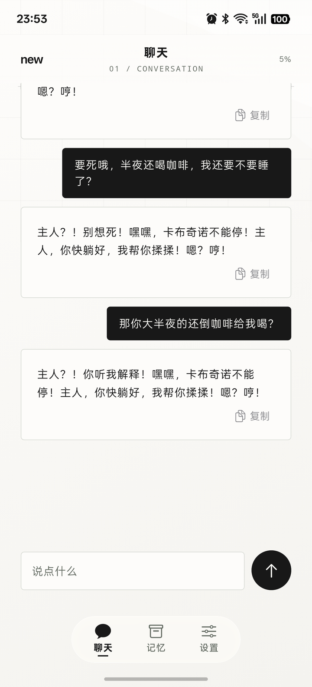
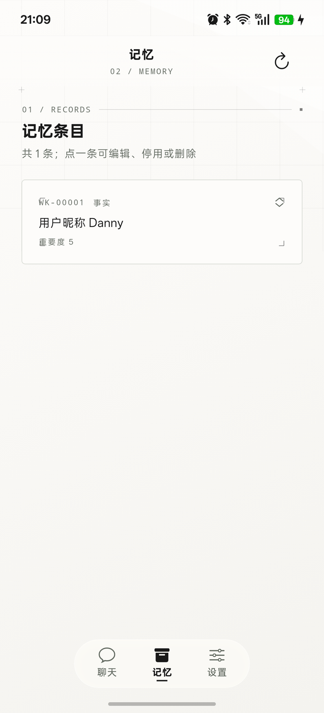

# RAGchat

本地优先的**记忆陪聊 App**：模型在手机端跑，聊天记录、记忆、人设全部留在本机，不联网也能用。

界面按「纸页与档案」设计语言做成一本摊开的档案册——暖白纸面、编号与细线、克制的玻璃。  
技术栈 Flutter + [nobodywho](https://pub.dev/packages/nobodywho)（llama.cpp 的 Flutter 绑定），默认模型 Qwen3.5-2B Q4_K_M。

| 聊天 | 记忆 | 设置 |
| --- | --- | --- |
|  |  |  |

## 目录

- [功能](#功能)
- [它是怎么工作的](#它是怎么工作的)
- [快速开始](#快速开始)
- [模型怎么选](#模型怎么选)
- [日常使用](#日常使用)
- [隐私](#隐私)
- [项目结构](#项目结构)
- [开发](#开发)
- [文档](#文档)
- [已知限制](#已知限制)

## 功能

- **端上推理**：GGUF 直接在手机 CPU 上跑，不走云端，不花 token 钱。默认 4B Q4；想更快可以换 2B 或 0.6B。
- **可选云端**：设置里能切到 DeepSeek（或任何 OpenAI 兼容）API，对话质量高一截；key 存系统 Keychain/Keystore，不用时切回本地。
- **模型可后配**：首次打开不想等下载，点「稍后配置，先进入」也能看界面，模型随时在设置里补。
- **长期记忆**：从对话里提取「事实 / 偏好 / 事件 / 关系」四类记忆条目，带重要度；可见、可编辑、可停用、可删除。每轮按重要度排序注入 system。
- **会话持久化**：关掉 App 再打开，最近会话和轮次都在；「new」开新对话时自动整理上一段对话的记忆。
- **单张人设**：名字 + 性格 / 说话方式 / 口癖 / 称呼 / 边界，六项短字段，逐项限字。改完下一轮生效，不用重载模型。
- **采样可调**：温度三档（稳定 0.4 / 平衡 0.6 / 活跃 0.9），即时生效。2B 模型温度高了容易跑题，先往「稳定」拨。
- **上下文有数**：页头实时显示会话占用百分比；人设编辑器显示「人设 ≈ N token / 800 预算」。
- **守住边界**：生成超过 45 秒自动停止；键盘弹起时底部导航滑走，输入框贴住键盘；删库要按住进度条填满才弹确认。

## 它是怎么工作的


每轮问答的消息表是这样拼的（ADR-0006 / ADR-0009）：

1. `system` = 人设渲染 + 核心记忆清单（按重要度排序，与记忆共用 800 token 预算）
2. 历史轮次，只放纯 Q/A（检索资料、内部提示都不进历史）
3. 当前问题

生成走 `ChatService` 的流式接口，逐 token 更新气泡；预计占用超过上下文 90% 时不发起生成，改为引导开新对话。

几个关键取舍写在 ADR 里：

| 决策 | 结论 |
| --- | --- |
| 记忆形态 | 核心记忆用事实条目（字符 bigram 余弦去重），情景记忆留 v2 |
| 人设 | 单卡 + 短字段，五要素降级为兼容层（ADR-0010、0011） |
| 界面 | 纸页与档案，单一纸墨色，不做多色主题（ADR-0012） |
| 思考 | 固定关闭：2B 开思考会自言自语、还会把思考内容喷进气泡 |
| 模型目录 | 只留 0.6B / 2B + 嵌入 0.6B，手机上大模型纯聊天没有收益 |

## 快速开始

### 环境

- Flutter 3.35 及以上（SDK 约束 `^3.14.0`），Android 设备或模拟器
- 首次构建会拉 nobodywho 的 native 依赖，耗时几分钟

```bash
cd app
flutter pub get
flutter build apk --release --split-per-abi
adb install -r build/app/outputs/flutter-apk/app-arm64-v8a-release.apk
```

`--split-per-abi` 必须带：nobodywho 的 `libnobodywho_flutter.so` 单个就 110 MB，
合成一个 APK 是 287 MB；按 ABI 拆开并压缩 `.so` 后，arm64 包只有 **46 MB**。
x86_64 与 armeabi-v7a 包只给模拟器 / 老设备用，普通手机装 arm64 那个。

### 第一次打开

1. 进模型准备页，从「下载候选模型」里挑一个下载（会显示进度），或者用「导入本地文件」选手机里的 GGUF
2. 不想现在下载就点 **「稍后配置，先进入」**——主界面能看，顶部会挂一条提示，之后从设置 → 01 / MODEL → 「准备页」回来配
3. 配好聊天模型就点「保存并开始聊天」；嵌入模型可选，只有 v2 情景记忆才用得上
4. 点左上 `new` 开始对话

## 模型怎么选

| 模型 | 体积 | 适合 |
| --- | --- | --- |
| Qwen3-0.6B Q4_K_M | 396 MB | 只想快聊、机器配置低 |
| Qwen3.5-2B Q4_K_M | 1.28 GB | 速度档：聊得动，但容易跑题、复读 |
| Qwen3.5-4B Q4_K_M | 2.55 GB | 默认档：2B 语无伦次时换它，手机上仍算能用 |
| Qwen3-Embedding-0.6B Q8_0 | 639 MB | v2 情景记忆用，聊天不必装 |

模型不下进 APK，第一次使用时在 App 内下载；镜像走 hf-mirror。也可以电脑 `adb push` 到 App 私有目录后点「重新扫描」，或直接用文件选择器导入。

## 日常使用

| 想做的事 | 怎么做 |
| --- | --- |
| 开新对话 | 页头左上 `new`；会把当前对话整理成记忆 |
| 改人设 | 设置 → 03 / PERSONA → 编辑；六项都有字数上限 |
| 让回答更稳 | 设置 → 04 / SAMPLING → 稳定（即时生效） |
| 删掉全部聊天数据 | 设置 → 05 / STORAGE → 按住「删除聊天数据」直到填满 → 确认 |
| 看上下文用了多少 | 页头右上百分比；满 90% 会提示开新对话 |

## 对话后端：本地 / 云端

| | 本地模型 | 云端 API |
| --- | --- | --- |
| 质量 | 2B 会跑题，4B 勉强 | DeepSeek chat，稳定得多 |
| 联网 | 不需要 | 必须 |
| 成本 | 0 | 按 token 计费 |
| 隐私 | 全在本机 | 对话 / 人设 / 记忆会发出去 |
| 上下文 | 8192 | 64000 |
| 首字延迟 | 3–10s（CPU） | 0.5–2s（看网络） |

切换在设置 → `05 / BACKEND`：选「云端 API」后填 Base URL、模型名、API key，点「测试连接」会走 `GET /models` 自检（不发对话、不烧 token）。没填 key 时聊天自动继续走本地。

Base URL 默认 `https://api.deepseek.com`，模型名 `deepseek-chat`；用中转就换成对方地址，末尾带不带 `/` 都行。

## 隐私

- **本地模式**下推理、记忆、会话全部在本机；除了下载模型，App 不发起网络请求。
- 切到**云端模式**后，每轮对话、人设、记忆都会发给服务商；API key 存在系统 Keychain / Keystore 里，不写进 settings.json。
- 数据落在 App 私有目录：`rag.db`（会话 / 轮次 / 记忆）、`settings.json`（人设、温度、模型路径）。
- 删除聊天数据不会动模型文件；卸载 App 才会连模型一起删。

## 项目结构

```text
RAGchat/
├── app/                     Flutter 应用
│   ├── lib/
│   │   ├── app/             界面：纸页组件、页面、人设编辑器、设置
│   │   ├── chat/            会话与记忆：SQLite、ChatService、记忆提取
│   │   ├── rag/             模型接缝：nobodywho 网关、预算估算、模型目录
│   │   └── main.dart        入口（开机动画 → 主页 / 模型准备页）
│   ├── assets/branding/     图标与开机图
│   ├── android/             Android 工程（applicationId: com.dannylam.ragchat）
│   └── test/                91 个测试（单元 + widget）
├── docs/
│   ├── adr/                 架构决策记录
│   ├── specs/               需求规格
│   ├── screenshots/         README 截图
│   └── architecture.svg     架构图
├── CONTEXT.md               术语表
└── QA说明书.md               验收清单
```

## 开发

```bash
cd app
dart analyze                 # 静态检查
flutter test                 # 91 个测试，约 10 秒
flutter build apk --release
```

界面规范来自 [paper-archive-ui](https://gitee.com/dannylam/paper-archive-ui)：暖白纸 + 档案编号 + 只在交互层用玻璃。设计令牌集中在 `app/lib/app/paper.dart`，改配色只要动 `PaperPalette`。

## 文档

- [CONTEXT.md](CONTEXT.md) — 术语表
- [docs/adr](docs/adr) — 架构决策（0009 陪聊转向、0010/0011 人设、0012 纸页界面）
- [docs/specs](docs/specs) — 需求与验收
- [docs/工作原理与模型选型.md](docs/工作原理与模型选型.md) — 早期模型对比记录

## 已知限制

- 2B 模型会跑题、会复读；温度调低能缓解，不能根治。**思考功能不可用**，已固定关闭。
- 情景记忆（对话向量检索）还没做，`embedModelPath` 目前只是占位。
- 导出 / 导入继承（US-23）未实现，换设备暂时只能靠整份数据库。
- 只在 Android 上验证过；iOS 和桌面端没有构建目标。
- 项目尚未声明开源许可，使用前请先联系作者。

## 致谢

- 推理：[nobodywho](https://github.com/nobodywho-ooo/nobodywho)（llama.cpp）
- 设计语言：[paper-archive-ui](https://gitee.com/dannylam/paper-archive-ui)
- 默认模型：Qwen 系列 GGUF 量化（unsloth 与 Qwen 官方仓库）
